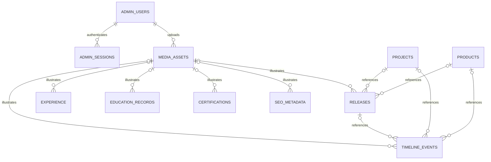

# Database architecture

[Handbook](README.md) · [Infrastructure and drivers](operations.md#hosting-and-database-choices) · [Recovery](recovery.md)

The [Admin Store](../../lib/admin/db.ts) exposes parameterized reads and
transactions. PGlite executes against an embedded database on the
configured path. The Aurora adapter uses the Data API and reuses the
transaction ID for the unit of work. Draft #14 adds a Neon WebSocket adapter
that holds a single connection through each interactive transaction and
bounds connection cleanup. Treat a network error around a write as ambiguous
until the intended data and audit state have been checked.

## Schema and integrity

| Migration | Purpose |
| --- | --- |
| [001 Core](../../lib/admin/migrations/001_init.sql) | Migration ledger, Projects, products and audit events |
| [002 Security](../../lib/admin/migrations/002_security.sql) | Users, sessions, login-attempt limits and security indexes |
| [003 Apps publishing](../../lib/admin/migrations/003_apps_publishing.sql) | Product lifecycle, presentation fields and link metadata |
| [004 Modules](../../lib/admin/migrations/004_modules.sql) | Media metadata, Experience, Education, Certifications, Releases, Timeline, SEO, redirects and flags |
| [005 Snapshots](../../lib/admin/migrations/005_publication_snapshots.sql) | Current published content keyed by entity type and record ID, with a conservative backfill |

These are selected physical foreign keys. Sessions reference users. Releases
require at least one Project or product. Timeline can reference Projects,
products and Releases. Audit points to actor and entity by application
identifiers. Published snapshots use polymorphic entity keys and can also
hold media IDs in their payloads. Application checks protect those references
in addition to the SQL constraints. Slug, email, path, storage-key and flag
uniqueness constraints apply where specified by the migration.

Lock the working row before an update that checks version or changes
publication state. Commit the working change, snapshot and audit together.
Use bound values and checked identifier allowlists. The driver must preserve
parameter order and transaction context, including when an audit write
fails. See [publication and rollback](publication.md) for stale-edit behavior.

## Migration contracts

On main, the explicit command runs each ordered file transactionally and
records the version. Reruns replay the reviewed idempotent SQL. Draft #14
adds checksum validation, a transaction-scoped ledger lock and skips an
applied version. A legacy row with a missing checksum is pinned to the
reviewed file without replay. Do not modify historical files, run competing
migrators or apply a migration during a build. Before any authorized
migration, verify the explicit environment, eligible restore point, tested
version, change compatibility and after-state ledger.

## Neon isolation and capacity

The connected project reported Free, PostgreSQL 18 and a Frankfurt region.
It contains a default production branch, a separate integration-review branch
and a reviewed isolated restore branch. Verify branch, compute, database and
role together. A branch created from parent data can contain historical
records. Use the dedicated reviewed synthetic source and exact destination
for recovery. Verify free-plan branch and compute limits, storage, transfer
and restore-history budget in the provider dashboard before scheduling
work. Those limits and current usage can change. [Neon plans](https://neon.com/docs/introduction/plans)

Use the pooled application configuration where applicable. Use direct TLS
connections for migrations and backup/restore; the reviewed recovery path
also verifies the endpoint name and address binding. Keep roles separate for
runtime, migration and recovery. Bind connection and database scope, use
least privileges and time-bounded credentials, and keep secret values in the
trusted runtime. The [Neon PR #14 design](https://github.com/wisheradam/adamwisher-portfolio/blob/28e7eefb3d5c3786da395a0a2570b8c7853a9339/docs/neon-postgresql.md)
records the adapter and remaining cutover questions. [Neon direct and pooled connections](https://neon.com/docs/connect/connection-pooling)
