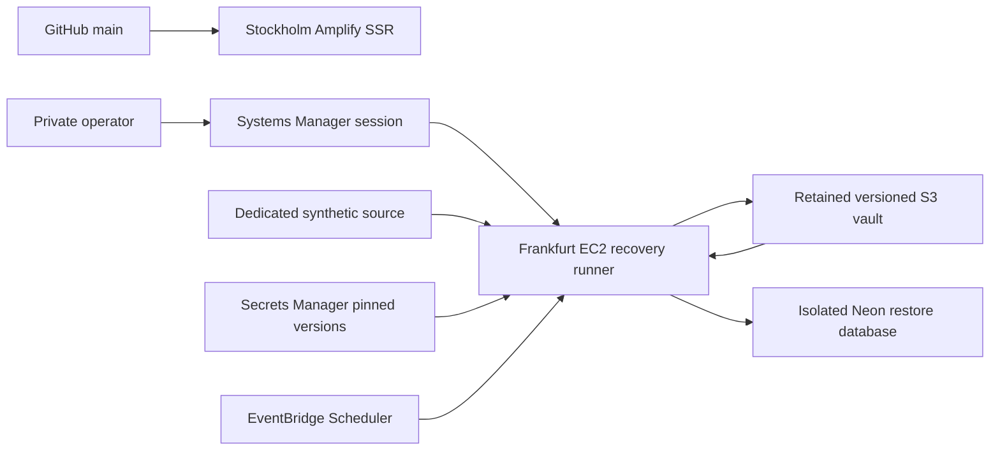

# Infrastructure, development and recovery

[Handbook](README.md) · [Architecture](architecture.md) · [Release history](history.md)

## Hosting and database choices

On November 22, 2026, read-only AWS inventory associated `adamwisher.com` with
the `adamwisher-site` Amplify WEB_COMPUTE app in Stockholm (`eu-north-1`).
The `main` branch had automatic builds enabled. Job 57 succeeded for
`ae1113dd084301613233934fdcd225eb1895a5a9`, the latest successful job returned and
the same commit as the source baseline. The hostname association was available.
The separately named `adamwisher-portfolio` app in Frankfurt had no custom-domain
association and had Auto Build disabled. Treat the two apps separately.

Stockholm has an SSR compute role. The reviewed app/branch environment **key
names** did not show the Admin database driver, Aurora identifiers, Neon URLs or
public content cutover keys. This does not attest what data survived in earlier
runtime files or prove a production Admin login. Neither Stockholm nor Frankfurt
returned an RDS cluster in the connected AWS account. No settings or secret
values were read into the handbook. Reverify job and branch metadata before any
release. A merge into main can trigger a production build.

| Store | Implementation | Operational status |
| --- | --- | --- |
| PGlite | PostgreSQL-compatible embedded store. Main defaults to `pglite` and `.data/admin-pg` when no explicit driver/path is configured. | Local development and isolated CI. A serverless local filesystem is unsuitable for durable production data. |
| Aurora PostgreSQL Data API | Main supports `aurora-data-api` with `AWS_REGION`, `ADMIN_DB_RESOURCE_ARN`, `ADMIN_DB_SECRET_ARN` and `ADMIN_DB_NAME`. The AWS SDK passes the Data API transaction ID through the work unit. | Adapter exists. Live Aurora, scoped permissions, production data migration and restore are unverified. |
| Neon PostgreSQL | Draft #14 adds `neon`. Use a pooled `ADMIN_DATABASE_URL` for application requests and a direct `ADMIN_DATABASE_DIRECT_URL` for explicit migration/bootstrap. The WSS adapter pins all statements in a transaction to one client and closes it after use. | Read-only Neon metadata verified a Free project in Frankfurt, PostgreSQL 18, with a default production branch, integration-review and an isolated restore branch. No production cutover is established. |

The Neon draft requires an explicit driver in production and validates Neon URLs
and TLS modes. The dedicated recovery tooling separately requires the reviewed
direct endpoint, host binding and verified TLS. A read-only control-plane
response establishes identity and configuration. It does not prove WebSocket
connectivity, credential operation, database isolation or recovery. Branch names
alone cannot establish that data is synthetic. Review plan quotas and usage on
the dashboard before any authorized workload.

Keep connection URLs and bootstrap hashes server-side. On Amplify, validate how
runtime settings reach the SSR handler. Grant service access through scoped IAM
roles rather than embedding credentials. Avoid printing secret values, session
tokens, connection strings or recovery identities.

References: [Amplify SSR environment settings](https://docs.aws.amazon.com/amplify/latest/userguide/ssr-environment-variables.html),
[Neon connection pooling](https://neon.com/docs/connect/connection-pooling),
[Neon plans](https://neon.com/docs/introduction/plans),
[Neon draft design](https://github.com/wisheradam/adamwisher-portfolio/blob/28e7eefb3d5c3786da395a0a2570b8c7853a9339/docs/neon-postgresql.md).

## Recovery infrastructure

The production Amplify app and Frankfurt recovery resources operate in separate
regions and have separate roles. The Frankfurt CloudFormation vault stack and
expired runner stack are present in the read-only inventory. The proposed
replacement and private portfolio media bucket belong to separate reviews.

The diagram describes the reviewed recovery data path. An expired runner has no
active instance, and a replacement must pass the [rehearsal gates](recovery.md#gates-before-a-live-rehearsal).

- **CloudFormation and networking.** The runner template uses a dedicated VPC
  and security group, no ingress, two pinned PostgreSQL destinations and HTTPS
  egress for required services and reviewed downloads. It requires IMDSv2 and
  encrypted, delete-on-termination gp3. Scope and expiration are bound to the
  approved artifact and ownership receipt.
- **Systems Manager and IAM.** Private Session Manager access replaces SSH.
  The instance role can read its exact recovery secrets and access the permitted
  vault prefix. Key initialization used a separate temporary policy, later
  removed. Verify effective write denial against the retained key before using a
  replacement. The scheduler role can terminate only the exact instance.
- **Encryption and retention.** PostgreSQL backup bytes pass through age before
  S3 storage. The vault applies SSE-S3 AES256, object versioning, public-access
  blocking and a TLS-only policy. Secrets Manager retains the version-bound age
  identity separately from the temporary connection configuration. The vault
  and held evidence survive runner teardown.
- **Cost and expiry.** One-time Scheduler termination covers compute. The
  operator verifies remaining EBS, AWS resources and PostgreSQL access using the
  reviewed cleanup procedure. Confirm cumulative cost evidence, current rates
  and time limits before launch. See the [cost and cleanup gates](recovery.md#gates-before-a-live-rehearsal).

[CloudFormation recovery design](https://github.com/wisheradam/adamwisher-portfolio/blob/28e7eefb3d5c3786da395a0a2570b8c7853a9339/docs/neon-ec2-recovery.md) ·
[Systems Manager Session Manager](https://docs.aws.amazon.com/systems-manager/latest/userguide/session-manager.html)

## Local setup and schema maintenance

1. Use Node.js 20 and `npm ci`. Review [the environment template](../../.env.example)
   and use an ignored local configuration and dedicated storage directories.
2. Set `ADMIN_DATABASE_DRIVER=pglite`, a disposable `ADMIN_DB_PATH`, and
   a separate `ADMIN_MEDIA_PATH`. Export the CLI variables in your trusted shell.
   Next.js loads `.env.local` for the app. Standalone Node scripts do not.
3. With a fresh local database, run `npm run admin:migrate`. Set
   `ADMIN_BOOTSTRAP_EMAIL` and a unique scrypt-format `ADMIN_PASSWORD_HASH` in the
   local operator environment, then run `npm run admin:bootstrap` once. Use
   `npm run dev` and open `/admin/login` on localhost. Bootstrap preserves existing
   users. Main's bootstrap tool supports PGlite and Aurora Data API. The example
   above is for local usage only.
4. Keep cutover switches absent for static behavior. To exercise review-mode
   publishing and redirects, use the isolated fixtures documented in
   [AGENTS.md](../../AGENTS.md) and [CI](../../.github/workflows/ci.yml). Review the
   importer reconciliation report before setting a matching knowledge fingerprint.

The [five migrations](../../lib/admin/migrations) cover core records and audit
(001), users/sessions/login limits (002), product publishing fields (003),
structured modules/media/configuration (004), and publication snapshots (005).
Main's [migration command](../../scripts/admin-migrate.mjs) sorts versioned files,
executes each in a transaction and records its version in
`admin_schema_migrations`. It replays the reviewed idempotent SQL on rerun. Draft
#14 adds checksum tracking, ledger locking and skip-on-applied, with one transaction
per file. Legacy missing checksums are pinned upon adoption and do not prove what
was applied previously. Use one migration runner. A query or build never applies
migrations. Do not edit applied migrations or add procedural SQL that the
semicolon-based parser cannot handle.

[The local SQLite importer](../../scripts/admin-import-sqlite.mjs) reads the
legacy store without writing it and preserves destination IDs.
[The knowledge importer](../../scripts/admin-import-knowledge.mjs) uses deterministic
IDs and reconciles public Experience, Education and Training entries without
replacing Admin edits. Review the report and compare source/destination counts
before approving a cutover. Local review stores and historical exports require
independent provenance before they can be treated as production sources.

## Account and publishing operations

1. Use an existing SUPER_ADMIN for user creation, role changes and deactivation.
   Grant the minimum role needed. Record the change, test that prior sessions
   fail where applicable, and check that an active SUPER_ADMIN remains.
   Use the authenticated Settings panel for a user's own password change.
2. Make changes to working content and check the Admin preview where available.
   For snapshot modules, verify the saved working record before explicit
   publication. Confirm eligible parent relationships, route gates and published
   content with a separate anonymous browser.
3. Archive to unpublish or use an approved delete operation. Verify the public
   response, child visibility, metadata and sitemap as applicable. Confirm the
   audit event and preserve the intended working copy. Follow
   [publication and rollback](publication.md) for legacy Project differences.
4. For a failed mutation, check HTTP status, role, Origin and request target,
   then the exact driver, schema and audit state. A stale write needs a refresh
   and a new reviewed edit. For a timeout or ambiguous commit, reconcile the
   current working row, snapshot and audit before retrying.

## Incident response

Record time, environment, revision, affected routes or identities and sanitized
error evidence. Preserve relevant audit and hosting records through the trusted
operator channel. For suspected account exposure, have an authorized
SUPER_ADMIN contain the affected access using account deactivation or credential
rotation as applicable. Confirm old sessions fail and keep the last active
SUPER_ADMIN available. Credential exposure beyond the app requires scoped
rotation through the owning provider. Check anonymous routes and files if
publication privacy was affected. For a recovery privilege incident, use the
independent cleanup channel and verify the exact baseline and open sessions
before closing the incident. Escalate production mutations for approval.

## Backup and recovery

**Local PGlite.** Stop processes using the store before copying the database
directory. Preserve the media directory alongside it and test the copy from a new
isolated path. Database files and media must agree. Validate migration versions,
counts, protected files, Admin authorization and anonymous publication.

**Aurora design.** Once a live cluster is provisioned and approved, confirm
retention, deletion protection and point-in-time recovery. Record the schema
version and snapshot before a release. Restore to a distinct cluster, validate
it with isolated runtime credentials and review an explicit configuration
switch. Live Aurora restore remains unverified.

**Neon review.** Provider history and branch restores do not replace a tested
independent encrypted backup. The draft operator path binds the approved source,
isolated target, artifact, immutable secret versions and short-lived runner. It
checks the exact synthetic table and fixture inventory, creates a versioned
encrypted archive and verifies integrity after a transactional restore. It
requires independently approved setup, catalog/ownership/cost checks, execution
review and cleanup. Keep authentication material and database contents outside CI
and Git. Disabled or expired runner receipts do not authorize a replacement.
Review the current PR before operating, since approvals, native DNS and cost
bounds can change.

- [Neon EC2 recovery runbook at the reviewed draft revision](https://github.com/wisheradam/adamwisher-portfolio/blob/28e7eefb3d5c3786da395a0a2570b8c7853a9339/docs/neon-ec2-recovery.md)
- [Synthetic source and isolation](https://github.com/wisheradam/adamwisher-portfolio/blob/28e7eefb3d5c3786da395a0a2570b8c7853a9339/docs/neon-synthetic-source.md)
- [Owner-side catalog inspection](https://github.com/wisheradam/adamwisher-portfolio/blob/28e7eefb3d5c3786da395a0a2570b8c7853a9339/docs/neon-catalog-inspection.md)
- [PostgreSQL pg_dump](https://www.postgresql.org/docs/18/app-pgdump.html) and [pg_restore](https://www.postgresql.org/docs/18/app-pgrestore.html)

**S3 media draft.** Restore metadata and its exact associated object versions as
a unit of recovery. S3 and PostgreSQL commit independently. An unknown commit
outcome needs metadata and audit reconciliation before removing an object.
Runtime IAM, production bucket setup, delivery privacy and full media recovery
remain deployment gates. The [media design and runbook](https://github.com/wisheradam/adamwisher-portfolio/blob/24aa5f61b8d79ab3189d2537271f5b7c2e05e165/docs/s3-media-storage.md)
describes the planned versioned private bucket and orphan review.

Before any production cutover, restore into an isolated environment and compare
constraints, table counts, migration versions and object references. Verify Admin
login and revocation, draft privacy, public metadata, publication and unpublication.
A code rollback leaves database, media and audit writes in place. Record the
rollback decision and reconcile writes that occurred after a backup.

## Release and rollback

1. Identify the exact PR head, reviewed base, migration set, deployment
   triggers, environment and scope of data changes. Require exact-head CI and
   the applicable live staging evidence described in [Testing](testing.md).
2. Verify database and media recovery evidence, scope operator permissions,
   and record the intended migration, deployment and data rollback boundaries.
   Obtain production release authorization before merging. Amplify main Auto
   Build can start a deployment after the merge.
3. After the authorized release, verify the Amplify job, revision and domain.
   Check Admin sign-in and revocation, role denials, persistent writes across
   a restart, draft isolation, direct routes, metadata, sitemap and media.
   Record the observed results and reconcile migrations and backups.
4. If a rollback is authorized, select the last known good application release
   or previous configuration and independently reconcile committed database
   and media changes. Code and configuration rollback leave those writes in
   place. Follow the reviewed backup procedure for data restoration and
   validate the same permissions and public surface after recovery.
